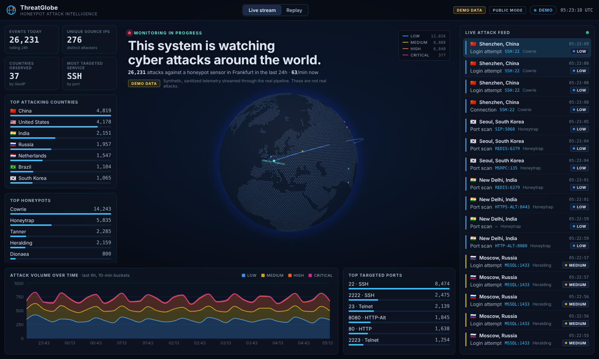
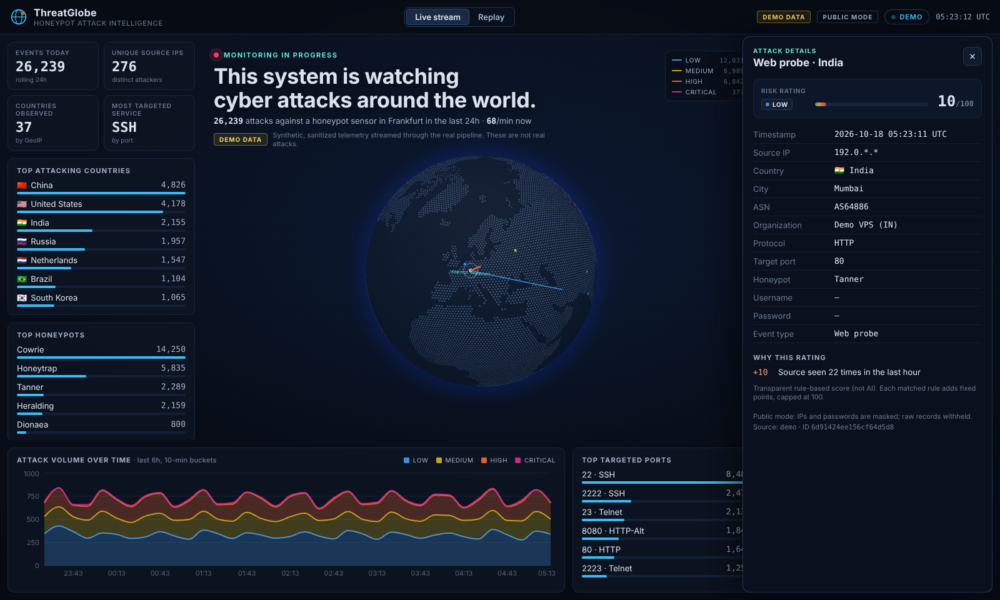
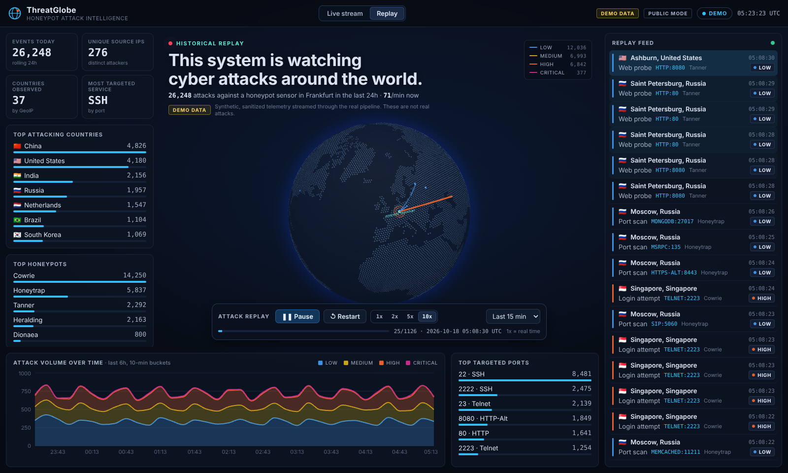
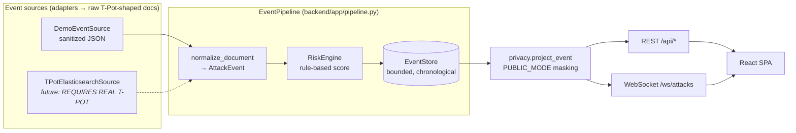

# ThreatGlobe

**Real-time cyber attack intelligence from honeypot telemetry.** FastAPI · WebSockets · React · TypeScript · react-globe.gl · Docker.



> **DEMO MODE.** Everything in the screenshots is synthetic, sanitized telemetry. It streams through the same normalization, scoring and privacy pipeline that real T-Pot data will use. **These are not real attacks.**

ThreatGlobe shows attacks against a honeypot sensor as they happen. Each event is an arc on a 3D globe, coloured by risk, from the attacker's location to the sensor. Around the globe sit live counters, top-N breakdowns, a volume timeline, a live feed, a detail drawer that explains each event's risk rating, and a chronological replay of stored history.

| | |
|---|---|
|  |  |

## Quick start

```bash
make demo          # builds + starts backend and frontend in Docker
open http://localhost:8080
make verify        # smoke-test the running stack (REST, WebSocket, privacy, headers)
make e2e           # ...plus the Playwright browser suite
make down
```

| URL | What |
|---|---|
| http://localhost:8080 | Dashboard (nginx serves the SPA and proxies `/api` and `/ws`) |
| http://localhost:8000/docs | OpenAPI / Swagger UI |
| ws://localhost:8080/ws/attacks | Attack stream |

Without Docker: `make install && make dev`. Backend runs on :8000 and Vite on :5173 (it proxies to the backend).

## Architecture



- **One pipeline.** Each source yields *raw* documents in the T-Pot/Logstash Elasticsearch layout (`@timestamp`, `src_ip`, `dest_port`, `type`, `eventid`, `geoip.*`, …). The demo dataset uses that layout too, so demo and real data share `normalize_document`, `RiskEngine`, the store and the privacy projection.
- **Push, not poll.** On connect the WebSocket sends a `hello` (recent events + stats snapshot). After that it sends one `attack` message per event and a `snapshot` (stats + timeline) every 5s. The client keeps headline counters up to date between snapshots.
- **Server-side only.** The browser talks only to the FastAPI backend, through the same-origin nginx proxy. It never talks to Elasticsearch. Credentials live only in backend settings (`SecretStr`), and tests assert that they never show up in any response.

```
backend/
  app/models.py          AttackEvent + response models
  app/normalize.py       raw doc → AttackEvent (tolerant of missing/garbage fields)
  app/risk.py            transparent rule-based scoring
  app/privacy.py         PUBLIC_MODE masking
  app/store.py           bounded in-memory store + aggregations
  app/pipeline.py        ingest → score → store → broadcast
  app/adapters/          demo.py (now), tpot.py (stub + ES query contract)
  app/api/               routes.py (REST), ws.py (WebSocket)
  data/demo_events.json  sanitized demo dataset (generated, deterministic)
frontend/src/
  components/GlobeView   react-globe.gl: hex-dot countries, arcs, impact rings
  hooks/useAttackStream  WebSocket + reconnect/backoff → DEMO/LIVE/RECONNECTING/OFFLINE
  hooks/dashboardState   pure reducer for feed/stats
  replay/ReplayController chronological replay engine (pure, unit-tested)
scripts/
  generate_demo_data.py  deterministic synthetic dataset generator
  verify.sh, ws_probe.py smoke test of a running stack
```

## Normalized model: `AttackEvent`

`id`, `timestamp`, `source_ip`, `source_latitude`, `source_longitude`, `source_country`, `source_country_code`, `source_city`, `source_asn`, `source_organization`, `destination_ip`, `destination_port`, `protocol`, `honeypot`, `username`, `password`, `command`, `event_type`, `severity`, `risk_score`, `risk_factors`, `raw_source_type`.

Only `id` and `timestamp` are guaranteed. The normalizer handles bad input without crashing:
- invalid IPs, ports, coordinates and ASNs become `null`
- control characters are stripped and long text is truncated
- an unparseable timestamp falls back to "now"

The UI shows "—" for any missing field. The demo dataset deliberately includes records without GeoIP data and with invalid ports to exercise this.

## Risk scoring (rule-based, not AI)

Each matched rule adds fixed points, and the total is capped at 100. The drawer lists every rule that fired, with its reason. The rule table is also exposed at `/api/status`.

| Rule | Points | Trigger |
|---|---:|---|
| privileged_username | 20 | root, admin, administrator, sa, oracle, postgres, ubnt, … |
| remote_shell_login | 10 | credential attempt against SSH/Telnet |
| brute_force | 20 | ≥5 login attempts from one source in 10 min (SSH/Telnet) |
| login_success | 25 | attacker obtained a (honeypot) shell |
| command_execution | 30 | commands run in the honeypot |
| malware | 45 | file download/upload |
| exploit_attempt | 25 | exploit / IDS signature |
| ics_target | 15 | Modbus/S7/etc. ports |
| repeated_source | 10 | ≥10 events from the source in 1 h |
| persistent_source | 10 | ≥50 events from the source in 1 h |
| abnormal_frequency | 20 | ≥20 events from the source within 60 s |

Ratings: **LOW** 0–24 · **MEDIUM** 25–49 · **HIGH** 50–74 · **CRITICAL** 75–100. Rules that depend on history use event timestamps rather than the wall clock, so scoring stored data is deterministic.

## Privacy: `PUBLIC_MODE=true` (default)

Events are stored unmasked internally, because scoring needs the real source identity. They are masked at the API boundary:

| Field | Public output |
|---|---|
| `source_ip` | `203.0.*.*` (IPv6: first two hextets) |
| `password` | first character + fixed `••••••` (length not leaked) |
| `destination_ip` | removed (the sensor's own address) |
| `command` | embedded IPs masked, URLs defanged (`hxxp[:]//`) |
| `raw` | withheld |

nginx also sends a strict Content-Security-Policy and other security headers.

## Demo data

`backend/data/demo_events.json` (2,400 docs) is produced by `scripts/generate_demo_data.py`. The generator uses a fixed seed and is reproducible with `make data`. The data is sanitized by construction:
- source IPs only from RFC 5737 documentation ranges
- ASNs only from the private-use range 64512–65534
- fictional organization names

The dataset's recorded inter-arrival gaps (bursty brute-force sessions, quiet periods) are rescaled to `DEMO_EVENTS_PER_SECOND`. The dataset is then looped:
- **backwards** from "now" to fill `DEMO_HISTORY_HOURS` of history
- **forwards** in real time as the live stream

History and live traffic therefore have the same density.

## Replay

**Replay** loads the last 5, 15 or 60 minutes from `/api/events?order=asc` and plays it back strictly by timestamp (stable sort, emitted by index). Controls: Play, Pause, Restart, and speeds 1x, 2x, 5x and 10x, where **1x is real time**. Quiet gaps are capped at 2s (divided by the speed) so playback never stalls.

## API

| Endpoint | Notes |
|---|---|
| `GET /health` | liveness |
| `GET /api/status` | source mode, public mode, counters, sensor, risk rules |
| `GET /api/stats?hours=24` | KPIs + top countries/ports/honeypots + severity counts |
| `GET /api/events` | `limit≤5000, since, until, severity, country, honeypot, port, order` |
| `GET /api/events/{id}` | 404 if unknown |
| `GET /api/countries`, `/api/ports`, `/api/honeypots` | top-N, `hours`, `limit` |
| `GET /api/timeline?hours=&bucket_minutes=` | rolling buckets ending now, split by severity |
| `WS /ws/attacks` | `hello`, `attack`, `snapshot`, `pong` messages |

## Configuration

See [`.env.example`](.env.example). The main settings are:
- `THREATGLOBE_SOURCE` (`demo`)
- `PUBLIC_MODE` (`true`)
- `DEMO_EVENTS_PER_SECOND` (`1.2`)
- `DEMO_HISTORY_HOURS` (`6`)
- `MAX_STORED_EVENTS` (`50000`, which also caps the history size)
- sensor location
- future `ELASTICSEARCH_*` settings

Building behind a TLS-inspecting proxy: both Dockerfiles accept an optional BuildKit secret, `extra_ca`. For example, a Compose override with `build.secrets: [extra_ca]` and a `secrets.extra_ca.file` pointing at your CA bundle. Without the secret, nothing changes.

## Testing

| Layer | Command | What |
|---|---|---|
| Backend | `make test-backend` | 67 pytest tests: normalizer edge cases, every risk rule, masking, store/aggregations, demo dataset sanitization, all endpoints, WebSocket stream, no secret leakage |
| Frontend | `make test-frontend` | 26 vitest tests: replay ordering/speeds/pause/restart, reducer, status mapping/backoff, components, App integration with a fake WebSocket |
| Stack | `make verify` | 28 checks against the running containers, including a stdlib WebSocket probe through nginx |
| Browser | `make e2e` | Playwright + Chromium (software WebGL): globe renders and animates, arcs fly, counters and feed update, WebSocket frames arrive, drawer opens, replay controls work, zero console errors |

CI (`.github/workflows/ci.yml`) runs lint + tests for both apps, `npm audit`, then `make demo` followed by `scripts/verify.sh --e2e`.

## Roadmap to real T-Pot

1. Implement `TPotElasticsearchSource`: authenticated search with `build_search_query` (already implemented and tested), using a `search_after` cursor for polling and an initial history load.
2. Run fixture tests against real T-Pot documents for each honeypot type (Cowrie, Dionaea, Honeytrap, Suricata, …), and extend `EVENT_ID_MAP`.
3. Set the status to **LIVE** (`mode: "live"`) when the T-Pot source is active. The UI already supports it.
4. Deploy behind TLS, keeping Elasticsearch on a private network and reachable only from the backend.

## Scope and ethics

ThreatGlobe is purely defensive: it visualizes and analyzes telemetry from honeypots you operate. It contains no scanning, attack-back, credential-stuffing or retaliation functionality.
